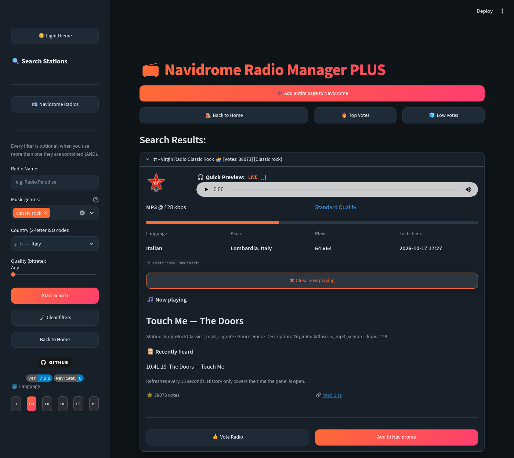
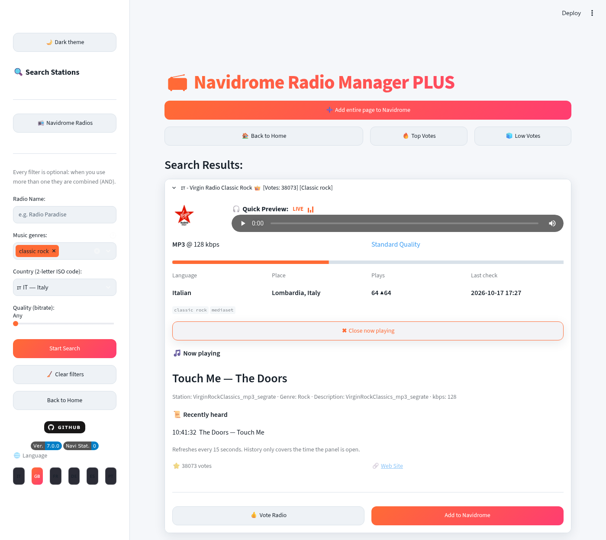

# 📻 Navidrome Radio Manager PLUS (NaviradioManager Plus)

Web app to search internet radio stations on [radio-browser.info](https://api.radio-browser.info/) and manage the radio stations of your [Navidrome](https://www.navidrome.org/) server.

> **This is a fork of [brunopiras/naviradiomanager](https://github.com/brunopiras/naviradiomanager)** by **Bruno Piras**, released under the MIT license. All credit for the original idea, the Navidrome integration and the base application goes to the original author. This fork adds a new interface, advanced search filters and live station info (see below). Not affiliated with, or endorsed by, the original author.

| Dark | Light |
|------|-------|
|  |  |

## What this fork adds

- **Modern interface**: card layout, rounded widgets, accent gradient, responsive sidebar.
- **Dark / light theme** with a button in the sidebar. The choice is kept in the URL (`?theme=light`), so it survives a reload.
- **Advanced search form**, every filter is optional and filters can be **combined** (AND):
  - **Name** of the station.
  - **Music genres**: about 600 genres (a curated list merged with the most used tags of radio-browser). You can pick several; the station must have all of them. You can also type a genre that is not in the list.
  - **Country** by ISO 3166-1 two-letter code (`IT`, `US`, ...), with flag and name.
  - **Quality** by bitrate: any, low (< 128 kbps), standard (128-191), high (≥ 192).
- **Radio-browser protocol compliance**: server discovery through `/json/servers` with random choice and fallback to the other servers, and a descriptive `User-Agent` on every request.
- **Now playing** for a selected station: current track and artist, stream info, and a "recently heard" list while the panel is open. It reads the ICY metadata of the stream, so it works only for stations that send it (most Shoutcast/Icecast ones). HLS streams and stations without metadata are reported as "not available".
- **More station info** in the results: language, place, plays with trend, last working check, tags, HLS / SSL warnings.
- **Six interface languages** (IT, EN, FR, DE, ES, PT) switchable from the flags at the bottom of the sidebar, without restarting or rebuilding. `APP_LANG` only sets the language shown at first load; the choice is kept in the URL (`?lang=fr`).
- Updated to current Streamlit (`st.iframe` instead of the removed `st.components.v1.html`).

Everything from the original is kept: add / remove / edit stations, bulk add of a result page, duplicate detection, stream test, voting.

## Quick start

You need a running Navidrome and a user of it.

```bash
git clone https://github.com/nightwatch75/NaviradioManagerPlus.git
cd NaviradioManagerPlus
cp .env.example .env
# edit .env (see below), then:
docker compose up -d
```

Open <http://localhost:8501>.

### Configuration (`.env`)

| Variable | Meaning |
|----------|---------|
| `APP_LANG` | Starting interface language: `IT`, `EN`, `FR`, `DE`, `ES` or `PT` (default `IT`). Users can change it from the sidebar |
| `TZ` | Time zone, for example `Europe/Rome` |
| `NAVIDROME_URL` | Base URL of Navidrome, reachable from the container |
| `NAVIDROME_USER` / `NAVIDROME_PASS` | Navidrome user and its **plain-text** password (a `$` must be written as `$$`) |
| `NAVIDROME_SALT` | Any random string you choose, see below |

**How to get the salt.** You do not retrieve it from Navidrome: you invent it. The app uses the Subsonic token authentication, `token = md5(password + salt)`, and sends both the token and the salt. Generate one with:

```bash
openssl rand -hex 8
```

If Navidrome answers `Wrong username or password` while the web login works, the password was probably saved with a different `ND_PASSWORDENCRYPTIONKEY`: set the password again from the Navidrome user page.

## Try the image

Published image: `ghcr.io/nightwatch75/naviradiomanagerplus:latest` (built by GitHub Actions on every push to `main`, for `amd64` and `arm64`).

```bash
docker run --rm -p 8501:8501 --env-file .env ghcr.io/nightwatch75/naviradiomanagerplus:latest
```

If the pull is denied, the package is still private: see [Publishing the image](#publishing-the-image).

Build it yourself instead:

```bash
docker build -t naviradiomanagerplus .
docker run --rm -p 8501:8501 --env-file .env naviradiomanagerplus
```

## Publishing the image

The workflow `.github/workflows/docker.yml` pushes the image to GitHub Container Registry (`ghcr.io`), not into the repository files. The first time GitHub creates the package it can be **private**. To make it public: GitHub profile → *Packages* → `naviradiomanagerplus` → *Package settings* → *Danger Zone* → *Change visibility* → *Public*.

## Credits and license

- Original project: [brunopiras/naviradiomanager](https://github.com/brunopiras/naviradiomanager) by Bruno Piras (MIT).
- Station directory: [radio-browser.info](https://www.radio-browser.info/), a community project. Please vote for the stations you like.
- This fork keeps the original [MIT license](LICENSE).
